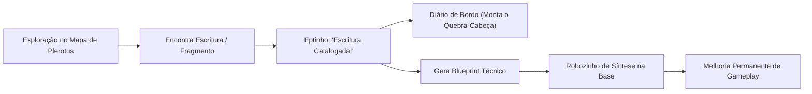
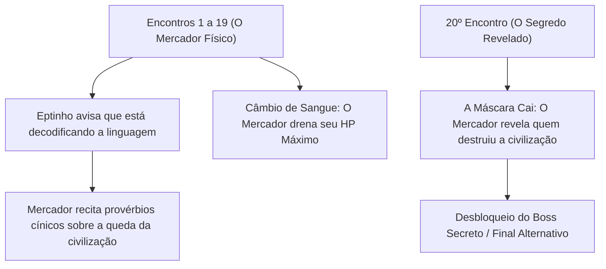

# 📜 DOCUMENTO DE DESIGN NARRATIVO & GAMEPLAY: O MISTÉRIO DE PLEROTUS

> **Status:** Proposta Consolidada para Implementação  
> **Tema Central:** Arqueologia Biológica, O Fungo Carnívoro, O Robozinho de Síntese e o Arquiteto da Queda  
> **Objetivo:** Transformar a curiosidade do jogador no motor principal do jogo através de pistas veladas, blueprints práticos e um antagonista manipulador.

---

## 🌌 1. A Verdade Oculta: O Ecossistema de Plerotus

### A. A Biologia do Planeta (O Fungo Predador)
O planeta **Plerotus** não é uma rocha inanimada nem uma entidade mística; ele é um macro-organismo fúngico predador (inspirado na biologia real do cogumelo carnívoro *Pleurotus ostreatus*).
* Na natureza, esse fungo desenvolve gotículas de toxinas ácidas para paralisar presas no solo e lança hifas invasivas que entram no corpo da presa, consumindo-a de dentro para fora.
* Em Plerotus, toda a crosta do planeta é um micélio vivo. As rochas e os cristais são extensões mineralizadas do fungo. As criaturas (Goblins, Aranhas, Golems) são organismos locais cujos sistemas nervosos foram completamente tomados por raízes fúngicas, agindo como anticorpos que defendem o parasita.

### B. O Protagonista e o Ponto de Partida
* O Engenheiro não é um guerreiro mítico; é um funcionário técnico e catalogador de dados de campo.
* A queda da nave foi um acidente autêntico causado pela distração de **Eptinho**, o copiloto Corgi.
* A **Indigestão Planetária:** Quando o Engenheiro morre, o solo tenta digeri-lo. Porém, seu sangue quente e sua composição humana não pertencem àquele ecossistema e causam uma violenta reação de rejeição celular (indigestão), fazendo o planeta reconstituir e expelir o astronauta na cratera da base.

---

## 🏛️ 2. As Escrituras da Civilização Perdida (O Quebra-Cabeça)

Antes de o parasita cobrir a superfície, existiu em Plerotus uma civilização inteligente de mineradores e arquitetos de silício. Eles viram o parasita brotar do núcleo e **lutaram contra ele**.

### A. Como o Jogador Encontra as Escrituras no Mapa
* Pelo mapa (em paredes rochosas, carcaças fossilizadas ou salas de anomalia), surgem marcas gravadas ou monólitos preservados.
* Ao se aproximar, o scanner do traje registra o fragmento automaticamente em 1 segundo.
* **Feedback Imediato:** Eptinho surge na lateral da tela em um pop-up com um latido digital:
  > *"Au! Escritura registrada no banco de dados! Analisando padrões técnicos..."*
* O texto do fragmento aparece brevemente e fica permanentemente acessível no diário de bordo da nave.

### B. A Tragédia Revelada (A História que se Constrói)
A cada escritura catalogada, o jogador monta o quebra-cabeça de por que a civilização foi dizimada:
1. **O Início:** A civilização descobriu que o fungo não era destruído com armas de demolição convencionais.
2. **A Descoberta da Fraqueza:** Eles descobriram que um composto químico neutralizador podia dissolver a membrana das hifas no núcleo.
3. **A Falha Trágica (O Sangue):** Para ativar o composto, era necessário um catalisador de sangue quente orgânico e rico em ferro. Por serem seres de silício e pedra, eles **não possuíam esse sangue**. Desesperados, tentaram sintetizar o fluido através de mutações extremas e colapsaram em guerras civis e paranoia mútua antes de terminarem a fórmula.

---

## 🤖 3. O Sistema de Blueprints do Robozinho (Melhorias Reais de Gameplay)

Para que as escrituras tenham propósito vital no jogo, algumas delas guardam **Blueprints de Engenharia Ancestral**. O jogador leva essas instruções para o **Robozinho de Síntese** na base da nave, que fabrica melhorias permanentes:

| Blueprint Catalogado | Lore da Escritura | Efeito Permanente no Robozinho |
| :--- | :--- | :--- |
| **Filtro Químico de Decomposição** | *"Eles descobriram que o ácido das poças reage a sais alcalinos..."* | Reduz em **40% o dano sofrido por veneno e poças ácidas** no mapa todo. |
| **Solenoide de Quebra-Casca** | *"Um estudo detalhado sobre as juntas das criaturas colossais..."* | Ataques do jogador causam **+20% de dano contra Armadura e Escudos** de inimigos Tanque (Golems e Peixe). |
| **Agente de Diluição de Hifas** | *"Fórmulas para impedir que os filamentos do solo grudem no maquinário..."* | Reduz a intensidade e a duração de qualquer **debuff de lentidão (Slow)** em 30%. |
| **Estabilizador de Frequência** | *"Diagrama de isolamento contra ondas sonoras sintonizadas..."* | Inimigos sob o efeito do buff do Sintonizador **não recebem bônus de velocidade de ataque**. |
| **Sonda de Fissura Mineral** | *"Mapas geológicos registrando onde o tecido do parasita costuma falhar..."* | Revela a localização de **Salas de Anomalia e veios raros** no mini-mapa da dungeon. |
| **O Catalisador Ancestral (Final)** | *"A última peça da fórmula neutralizadora de Plerotus..."* | Desbloqueia a **Arma Química Ancestral** para o confronto definitivo no núcleo. |

---

## 🕳️ 4. A Sala de Anomalia: O Erro Biológico de Plerotus

A Sala de Anomalia é uma das mecânicas de mistério mais atmosféricas:

* **O Conceito:** Não é um templo ou uma sala mágica. É uma **Fissura de Necrose Tecidual**. Mesmo um fungo colossal comete erros de replicação celular; a anomalia é um local onde a digestão do parasita falhou ou deu curto-circuito.
* **Ambientação Velada e Sutil:**
  * O gerador procedural cria essa sala como um beco sem saída raro (1 a cada 3 ou 4 runs).
  * Não há inimigos, e as portas nunca travam.
  * A música agitada de combate cessa completamente, dando lugar a um silêncio pesado com ruído branco de baixa frequência.
  * A paleta de cores fica **desbotada e leitosa** (tons de cinza e poeira fosca), como se a vida tivesse sido drenada daquele setor.
* **O que há dentro:**
  * No chão repousa um **Nódulo de Rejeição** (matéria expelida e não digerida pelo parasita) ao lado de uma carcaça fossilizada da civilização ancestral.
  * O jogador interage com o nódulo e recebe:
    1. **Uma Escritura Rara Garantida:** Avança a pesquisa do Robozinho de Síntese.
    2. **Instabilidade Genética (Dilema de Run):** Uma mutação instável que modifica as regras daquela descida (ex: *"Ataques causam estilhaços ácidos extras, mas o tempo de recarga da esquiva aumenta em 0.15s"*).

---

## 🎭 5. O Mercador: O Falso Aliado e o Arquiteto da Tragédia

O Mercador é a figura central do suspense e a grande virada do jogo.

### A. Quem ele é de verdade?
* O Mercador é um **ser alienígena físico e vivo**. Ele **não é humano** e nunca foi um astronauta.
* Ele é um organismo simbiótico antigo que coexiste com o parasita. Ele **não é uma figura do bem**: ele é cínico, manipulador e vive do sangue daqueles que caem em Plerotus.
* **Por que ele quer o seu Sangue?**
  * O Mercador sabe que o sangue do engenheiro é a chave para neutralizar o parasita.
  * Se o parasita for curado, o mundo morre e o negócio do Mercador acaba.
  * Por isso, ele oferece o **Câmbio de Sangue**: ele finge que está te ajudando com Essência imediata, mas na verdade está **drenando a sua única arma natural**, trancando sua vida em correntes para garantir que você morra nas mãos do Boss final antes de descobrir a verdade!

### B. A Linguagem do Mercador (Os Estalos Minerais)
Ele não rosna nem ruge. Ele produz sons atritando anéis de silício nos dedos e nas cordas vocais. Conforme Eptinho acumula registros das conversas, os diálogos deixam de ser ruído e se tornam **enigmas cínicos**:
* *"Eles também achavam que ferramentas de metal podiam quebrar raízes vivas... o pó deles ainda está sob os seus pés."*
* *"O sangue é um líquido tão desperdiçado em corpos que respiram. Na pedra, ele é uma chave... uma pena que você prefira queimá-lo por moedas."*
* *"Continue marchando para a câmara do Guardião, pequeno engenheiro. Os outros também achavam que havia uma saída do outro lado."*

### C. O 20º Encontro (O Clímax & O Boss Secreto)
Quando o contador de encontros atinge 20 visitas no `SaveManager`:
1. **A Máscara Cai:** Eptinho traduz com clareza total. O Mercador não oferece itens. Ele percebe que o jogador montou os blueprints da civilização e está quase completando a fórmula neutralizadora com o próprio sangue.
2. **A Revelação:** O Mercador revela que **foi ele quem trouxe o esporo de Plerotus** eras atrás e foi ele quem semeou a paranoia que fez a civilização antiga se extinguir.
3. **O Desafio do Falso Amigo (Boss Secreto):**
   * O Mercador fecha a sua mala e confronta o jogador.
   * Ele luta utilizando as próprias Cartas de Maldição do Tarô Proibido e o sangue que acumulou de você ao longo de todas as runs passadas.
   * Derrotá-lo liberta o planeta e desbloqueia o **Final Verdadeiro da História**.

---

## 🛠️ 6. Roteiro de Implementação no Projeto

Para colocar tudo isso na Unity de forma limpa e modular:

1. **Passo 1: Banco de Dados de Escrituras (`ScriptableObjects`):**
   * Criar o ScriptableObject `LoreScriptureData` com `id`, `titulo`, `textoFragmento`, `blueprintAssociado` e `audioEptinho`.
2. **Passo 2: Prefab de Interação de Escritura no Mapa (`ScripturePickup.cs`):**
   * Um objeto interativo pequeno com brilho sutil que dispara o evento de catalogação e o pop-up do Eptinho no HUD.
3. **Passo 3: Módulos de Síntese no Robozinho:**
   * Adicionar no menu do robô na Base a aba das melhorias permanentes desbloqueadas pelas escrituras.
4. **Passo 4: Contador do Mercador no `SaveManager.cs`:**
   * Adicionar a variável `merchantInteractionsCount` e vincular à tabela dos 20 diálogos enigmáticos.
5. **Passo 5: Prefab da Sala de Anomalia (`Room_Anomaly`):**
   * Criar a variante de beco sem saída desbotada/silenciosa com o Nódulo de Rejeição.

---
*Documento pronto para leitura e alinhamento com a equipe.*
